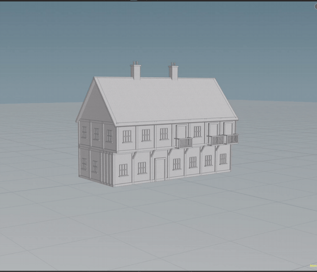
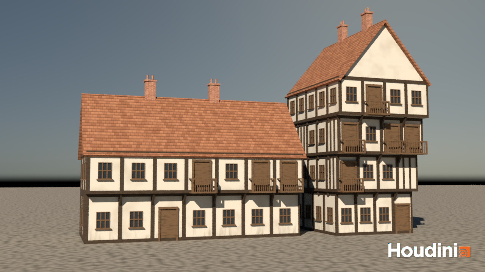

# Procedural Timber Buildings

A Houdini tool that builds old English half-timbered houses: white walls, dark wooden frames, upper floors that stick out over the street, tiled roofs, and brick chimneys. One HDA, two very different buildings, just by changing parameters.

Full video: **[watch on YouTube](https://youtu.be/d1OYhexmujA)**

## The two buildings I based it on

| Wide, low country inn | Tall, narrow town house |
|---|---|
|  |  |
| The Swan Hotel, Lavenham. Two floors, a long front, one overhanging upper floor. | The Feathers Hotel, Ludlow (the one on the right). Four floors, each one sticking out more than the last. |

Photo credits: Swan Hotel by Oxyman (2008), [Wikimedia Commons](https://commons.wikimedia.org/wiki/File:Lavenham_-_Swan_Hotel.jpg), [CC BY-SA 2.0](https://creativecommons.org/licenses/by-sa/2.0/). Feathers Hotel by Mick Knapton (2003), [Wikimedia Commons](https://commons.wikimedia.org/wiki/File:Feathers_Hotel_Ludlow.jpg), [CC BY-SA 3.0](https://creativecommons.org/licenses/by-sa/3.0/).

## How to try it

1. Open `buildings.hipnc` (the HDA is embedded, nothing else to install).
2. Go to `/obj/building` and click `timber_building1` once.
3. Gear icon → **Legacy Presets** → **Swan Inn** or **Feathers Town House**. Then play with the sliders.
4. Want colors? Go to `/stage`. Want the final picture? Click `karma_render` → **Render to MPlay**.

## How it works

**Part 1: stacking boxes.** Every floor has its own block of settings (a multiparm): height, size, how far it sticks out ("jetty"), and an offset. A wrangle turns that into one point per floor, and a box gets copied onto each point.

**Part 2: doors, windows, balconies.** Each wall gets chopped into slots. For every slot, the tool picks a door, a window, a balcony, or nothing. The rules: one front door on the ground floor, no balconies down there, balconies only on upper floors facing the street, and every balcony comes with a door behind it. Each part has its own yellow control node:

| Part | Size knobs | Extra knob |
|---|---|---|
| Window | width, height | how many panes |
| Door | width, height | single or double |
| Balcony | width, railing height, depth | spindles or solid boards |
| Chimney | width, height | clay pots on or off, how many |

**Part 3: posts and beams.** A post goes on every slot edge, a beam runs along the top and bottom of every wall, and plain walls get thin upright studs. All of it is one box stretched to different sizes.

**Part 4: supports.** For each post on an upper floor, the tool shoots a ray back into the building to see how far that floor hangs out over the one below. If it sticks out, it gets a brace.

**Part 5: extras.**
- *Smarter supports:* a short overhang gets a little wooden block, a medium one gets a diagonal brace, and a long one over the street also gets a post down to the ground.
- *Roof and chimneys:* a gable roof sits on the top floor, with triangle walls at the ends. The ridge follows the longer side by default, so the inn gets side gables and the town house gets a gable facing the street. Chimneys sit along the ridge and can slide down the back slope.

**Polish.**
- Each floor can pick its own window style (normal, wide, tall, small) and turn its balconies or studs off.
- Two built-in presets.
- I tested 25 weird settings (1 floor, 6 floors, huge offsets, everything turned off...) and none of them break it.

## Rendering (extra credit)

- Two copies of the same HDA, one set up as the inn and one as the town house, standing side by side on a cobbled street.
- UVs are projected in meters, so textures are the same size on every part.
- Seven MaterialX materials, all made from noise with no image files: plaster with dirt near the ground, dark oak, lighter wood, glass, roof tiles, bricks, and cobbles.
- Roof tiles and bricks use a staggered pattern with dark or light gaps.
- Lighting is a warm sun plus a physical sky. Rendered in Karma at 1280×720 (the Apprentice limit).

## Files

- `buildings.hipnc`: the scene, with the HDA embedded.
- `render/street.png`: the final render.
- `demo.gif`: the short demo above.
